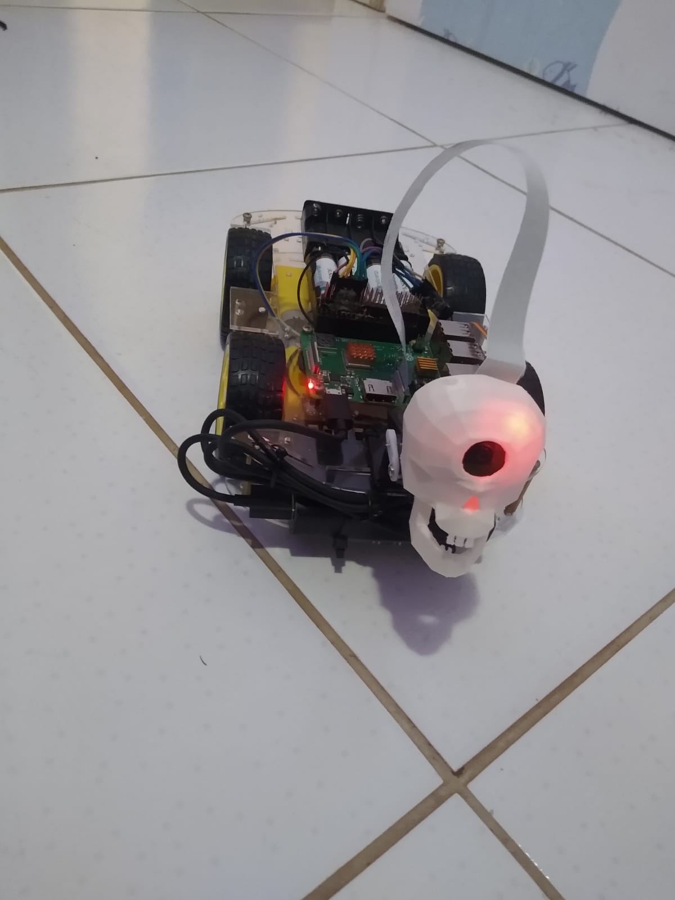
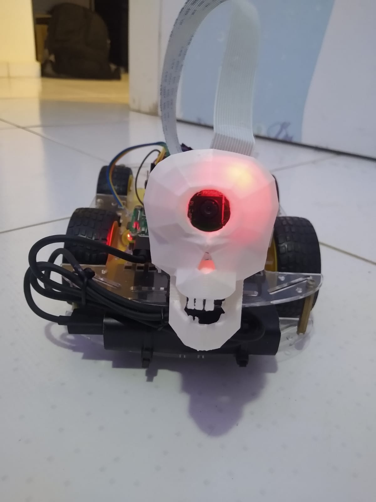
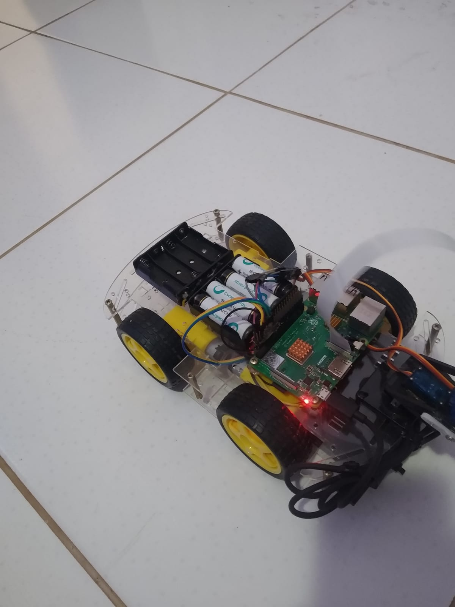

# raspberry-python-robo-server
[](https://github.com/renantescaro/raspberry-python-robo-server/actions/workflows/tests.yml)

Servidor que roda no Raspberry Pi 3 B+ e controla o robô:

* recebe comandos do [cliente](https://github.com/renantescaro/raspberry-python-robo-client) por socket TCP (protocolo binário de 4 bytes)
* motores DC por ponte H
* câmera com movimento vertical / horizontal utilizando servomotores
* sensor ultrassônico (opcional)
* watchdog: para os motores se a conexão cair ou o cliente parar de responder
* auto-atualização via `git pull` ao iniciar

<div style="display: flex">
    
    
    
</div>

## Instalação no Raspberry Pi

```bash
sudo apt-get install python3-lgpio python3-dotenv   # já vêm no Raspberry Pi OS Bookworm/Trixie

# --system-site-packages: o lgpio/RPi.GPIO do sistema ficam visíveis no venv
python3 -m venv --system-site-packages venv
source venv/bin/activate
pip install -r requirements.txt
cp .env.example .env                  # ajuste os pinos (numeração BCM)
python main.py
```

Com `GPIO_BACKEND=auto` o servidor escolhe, nesta ordem:

1. **pigpio** – só se o daemon `pigpiod` estiver rodando (servos por DMA). O pacote não existe mais no Trixie.
2. **lgpio** – padrão no Bookworm/Trixie.
3. **RPi.GPIO** – fallback com PWM por software.

## Serviço (iniciar no boot)

```bash
sudo cp deploy/robot-server.service /etc/systemd/system/
sudo systemctl daemon-reload
sudo systemctl enable --now robot-server
journalctl -u robot-server -f        # logs
```

O arquivo assume o usuário `robot` e o projeto em `/home/robot/raspberry-python-robo-server`; ajuste se for diferente.

## Simulador (qualquer PC)

```bash
python main.py --simulate
```

Não acessa o GPIO: apenas registra no log os comandos recebidos. Útil para testar o cliente.

## Opções

* `--simulate` – usa o backend falso de GPIO
* `--no-update` – não executa o `git pull`
* `-v` – log detalhado

Todas as configurações estão documentadas em `.env.example`.

## Testes

```bash
pip install -r requirements-dev.txt
pytest                                   # unitários, integração e contrato
pytest tests/test_contract.py -v         # só o contrato do protocolo
```

Os testes de contrato validam o `protocol.py` contra `tests/contract/protocol_vectors.json`.
Se o repositório `raspberry-python-robo-client` estiver clonado na pasta ao lado (ou em `PEER_REPO_DIR`),
também testam a compatibilidade cruzada com ele. `tests/test_contract.py` e o arquivo de
vetores devem ser **idênticos** nos dois repositórios.

O GitHub Actions (`.github/workflows/tests.yml`) roda tudo a cada push na `master` e em pull requests;
o job de contrato baixa o outro repositório na branch de mesmo nome (ou `master`).
